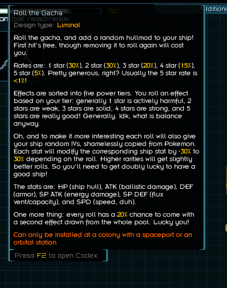
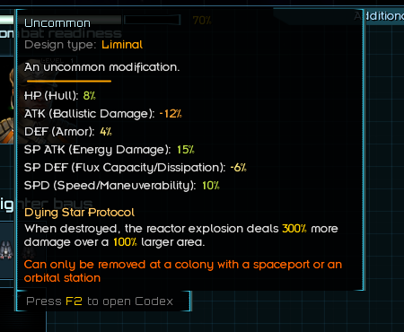
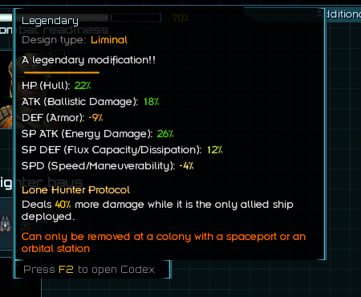
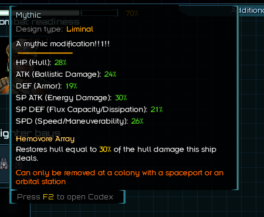

# Gacha Hullmods
> It's F2P friendly! You can beat the entire story with just free characters.
> - Every Gacha Game Player talking about their favourite game

Have you ever wanted your ships to be more random? Sad that you can't get enough dopamine from opening research stations? Want more surprise mechanics?

Well roll the dice, applying a random effect to your ships! Unlock the hullmods at Galatia Academy.

[Forum link](https://fractalsoftworks.com/forum/index.php?topic=32287)

## Screenshots

